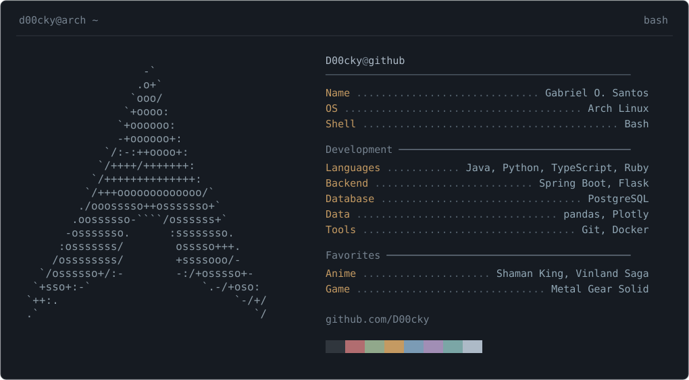
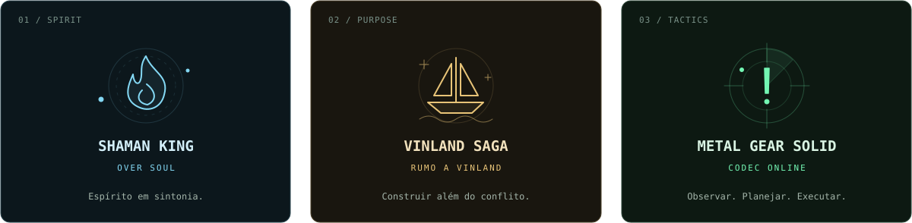

<p align="center">
  
</p>

```console
gabriel@github:~$ whoami
Gabriel O. Santos · D00cky

gabriel@github:~$ cat sobre.txt
Construo APIs, exploro dados e aprendo colocando projetos em prática.
Por aqui: Java e Spring Boot, Python e uma boa dose de terminal.
```

### `~/stack`

```text
backend    Java · Spring Boot · Python · Flask
dados      PostgreSQL · pandas · Plotly
ferramentas Docker · Git · Linux
```

### `~/projetos`

| Projeto | O que tem por lá | Stack |
| :--- | :--- | :--- |
| [PythonExcelDashBoard](https://github.com/D00cky/PythonExcelDashBoard) | De planilhas Excel a dashboards interativos, com filtros e exportação de relatórios. | Python · Flask · pandas · Plotly |
| [BlogPosting](https://github.com/D00cky/BlogPosting) | API de blog com usuários, posts, comentários e migrações de banco. | Java · Spring Boot · PostgreSQL · Docker |
| [DexJava](https://github.com/D00cky/DexJava) | Integração com a PokéAPI e persistência de Pokémon em banco relacional. | Java · Spring Boot · PostgreSQL |

### `~/savepoints`

<p align="center">
  
</p>

```console
gabriel@github:~$ codec --status
[CONEXÃO ESTABELECIDA]
Próxima missão: transformar ideias em código.
```

<p align="center">
  <a href="https://github.com/D00cky?tab=repositories">explorar repositórios ↗</a>
</p>
